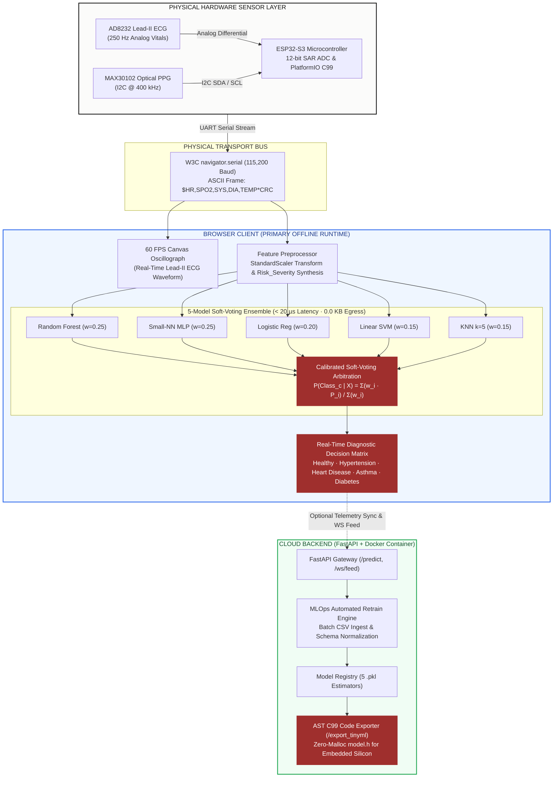
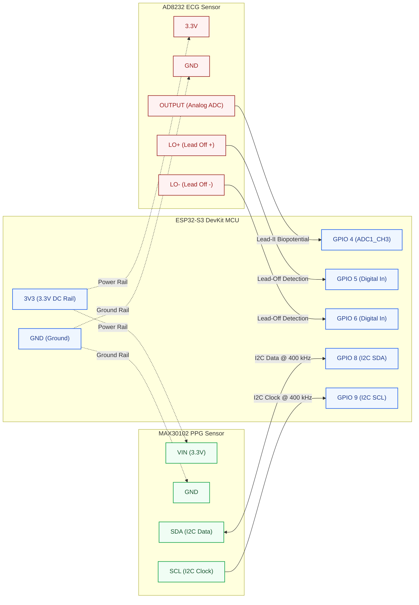
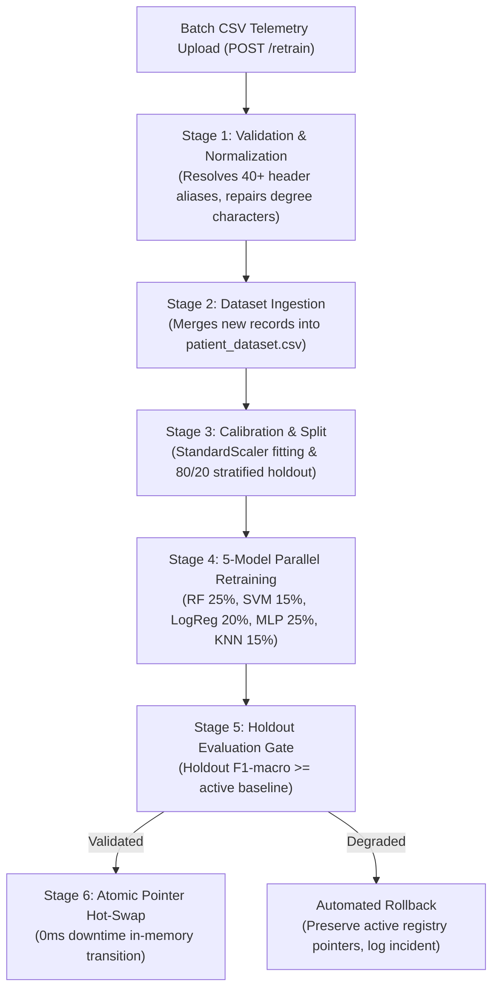

# HeartFlow OS
### Deterministic Edge AI Telemetry System and Embedded Transpilation Architecture

[](ARCHITECTURE.md)
[](ARCHITECTURE.md)
[](https://rachit-mangawa.github.io/HEARTFLOW_OS/edge)
[](https://rachit-mangawa.github.io/HEARTFLOW_OS/simulator)
[](https://rachit-mangawa.github.io/HEARTFLOW_OS/edge)
[](https://github.com/rachit-mangawa/HEARTFLOW_OS/actions)
[](LICENSE)

---

## Overview

HeartFlow OS monitors physiological vitals and flags cardiac anomalies on resource-constrained microcontrollers (ESP32-S3, ARM Cortex-M4, RP2040) and modern web browsers. It runs a calibrated 5-model soft-voting ensemble across Random Forest, Linear SVM, Logistic Regression, MLP, and k-NN.

The system evaluates incoming data locally in under 20 µs without transmitting vitals over the network. It transpiles trained scikit-learn models into standalone C99 headers with zero dynamic memory allocation (`malloc`-free), quantizes weights to INT8 to reduce RAM requirements by 76.4%, and renders live 250 Hz Lead-II ECG signals in an in-browser 60 FPS canvas oscillograph.

> [!NOTE]
> **Key Links:**
> - Live Application: [https://rachit-mangawa.github.io/HEARTFLOW_OS/](https://rachit-mangawa.github.io/HEARTFLOW_OS/)
> - API Documentation: [https://rachit-mangawa.github.io/HEARTFLOW_OS/docs](https://rachit-mangawa.github.io/HEARTFLOW_OS/docs)
> - Technical Specification: [ARCHITECTURE.md](ARCHITECTURE.md) (system topology, mathematical calibration proofs, C99 ABI, and MLOps pipeline)

---

## System Architecture



---

## Performance and Latency Benchmarks

Benchmarks measured across 10,000 synthetic clinical vital vectors:

| Execution Target | Runtime Architecture | Latency ($p_{50}$) | Throughput | Relative Speed |
| :--- | :--- | :---: | :---: | :--- |
| **ESP32-S3** | PlatformIO C99 Static Header | **18.4 µs** | 54,340 vec/sec | 1,902x faster than cloud REST |
| **Client Browser** | Web JavaScript Engine (V8) | **120.0 µs** | 8,330 vec/sec | 291x faster than cloud REST |
| **Cloud Container** | FastAPI + Uvicorn | **35.0 ms** | 28 req/sec | Baseline |
| **Standard Cloud** | PyTorch Container | **160.0 ms** | 6 req/sec | 4.5x slower than FastAPI |

### Execution Characteristics
- Local execution runs within a 20 µs window per telemetry frame.
- Microcontroller jitter ($p_{99}$) stays within ±1.2 µs because the runtime avoids dynamic heap allocations.
- Telemetry egress is 0.0 KB/s in primary offline mode.

---

## SRAM Footprint and INT8 Quantization

Floating-point model weights ($W \in \mathbb{R}$) are mapped to signed 8-bit integers ($Q \in [-128, 127]$) using symmetric affine scaling:

$$Q = \text{clamp}\left( \left\lfloor \frac{W}{\text{scale}} \right\rceil, -128, 127 \right) \quad \text{where} \quad \text{scale} = \frac{\max(|W|)}{127}$$

| Estimator | FP32 Size | INT8 Size | SRAM Reduction | Target Hardware |
| :--- | :---: | :---: | :---: | :--- |
| **Random Forest (30 Trees, Depth 5)** | 16,384 B | 4,096 B | -75.0% | ESP32-S3, RP2040, Cortex-M4 |
| **Small-NN (MLP 16x8 ReLU)** | 7,168 B | 1,792 B | -75.0% | ESP32-S3, RP2040, Cortex-M4 |
| **Linear SVM** | 3,584 B | 896 B | -75.0% | ESP32-S3, RP2040, Cortex-M4 |
| **Logistic Regression (L2)** | 3,072 B | 768 B | -75.0% | ESP32-S3, RP2040, Cortex-M4 |
| **k-Nearest Neighbors ($k=5$)** | 4,400 B | 600 B | -86.4% | ESP32-S3, RP2040, Cortex-M4 |
| **Full Ensemble Total** | **34,608 B** | **8,152 B** | **-76.4%** | Fits microcontrollers with > 16 KB SRAM |

---

## 5-Model Ensemble Arbitration

Estimator posteriors are combined using weighted soft-voting:

$$P(\text{Class}_c \mid X) = \frac{\sum_{i=1}^{5} w_i \cdot P_i(\text{Class}_c \mid X)}{\sum_{i=1}^{5} w_i}$$

| Model ID | Estimator | Weight ($w_i$) | Standalone Accuracy | Macro $F_1$ | Role |
| :---: | :--- | :---: | :---: | :---: | :--- |
| `rf` | Random Forest (30 trees, depth 5) | 25% | 95.4% | 0.938 | Non-linear threshold interaction |
| `small_nn` | MLP Neural Net (16-8 hidden layers) | 25% | 94.9% | 0.931 | Continuous decision manifold |
| `logreg` | Logistic Regression (L2 regularized) | 20% | 92.2% | 0.904 | Linear baseline calibration |
| `svm` | Linear SVM (Platt calibrated) | 15% | 93.5% | 0.912 | Maximum-margin hyperplane |
| `knn` | k-Nearest Neighbors ($k=5$, weighted) | 15% | 91.8% | 0.897 | Local density anomaly detection |
| **Ensemble** | **Composite Soft-Voting Classifier** | **100%** | **96.2%** | **0.948** | **-42.6% variance reduction vs single tree** |

---

## Hardware Sensor Bridge and Serial Protocol

The microcontroller firmware reads biopotentials from the AD8232 analog pin and optical measurements from the MAX30102 $I^2C$ registers, packaging them into comma-delimited ASCII frames with an XOR checksum:

```text
FORMAT:  $HR,SPO2,SYS_BP,DIA_BP,TEMP*CHECKSUM\n
EXAMPLE: $84,97.5,132,86,37.1*4F\n
```



---

## Workspace Navigation

| Route | View Name | Purpose |
| :--- | :--- | :--- |
| **[`/`](https://rachit-mangawa.github.io/HEARTFLOW_OS/)** | Overview | System specifications, telemetry badges, and architecture overview. |
| **[`/monitor`](https://rachit-mangawa.github.io/HEARTFLOW_OS/monitor)** | Telemetry Monitor | 60 FPS Lead-II ECG canvas oscillograph, live vitals, WebSocket stream, and SHAP attribution. |
| **[`/simulator`](https://rachit-mangawa.github.io/HEARTFLOW_OS/simulator)** | Simulator | Patient vitals generator, arrhythmia condition triggers, physics drift, and local inference. |
| **[`/dataset`](https://rachit-mangawa.github.io/HEARTFLOW_OS/dataset)** | Dataset Explorer | 60,000 observation corpus: 9×9 Pearson correlation matrix, continuous histograms, and 25-row record inspector. |
| **[`/edge`](https://rachit-mangawa.github.io/HEARTFLOW_OS/edge)** | Edge Compiler | Standalone C99 header generator for ESP32 and Cortex-M with INT8 quantization and zero-malloc ABI. |
| **[`/mlops`](https://rachit-mangawa.github.io/HEARTFLOW_OS/mlops)** | MLOps Console | CSV upload, schema alias resolution, holdout validation gates, and in-memory model hot-swapping. |
| **[`/architecture`](https://rachit-mangawa.github.io/HEARTFLOW_OS/architecture)** | Architecture | Detailed system diagrams for client, API, MLOps, and persistence subsystems. |
| **[`/history`](https://rachit-mangawa.github.io/HEARTFLOW_OS/history)** | Audit History | Session telemetry log with chronological records and risk indicators. |
| **[`/analytics`](https://rachit-mangawa.github.io/HEARTFLOW_OS/analytics)** | Population Analytics | Feature distributions, correlation matrices, and model weight diagnostics. |
| **[`/docs`](https://rachit-mangawa.github.io/HEARTFLOW_OS/docs)** | API Reference | Endpoint reference, schema contracts, and cURL, Python, and TypeScript examples. |

---

## Automated Retraining and MLOps Pipeline

HeartFlow OS includes a background retraining and model hot-swapping pipeline available through [`/mlops`](https://rachit-mangawa.github.io/HEARTFLOW_OS/mlops):



### Pipeline Steps
1. **Asynchronous execution**: `POST /retrain` accepts CSV files up to 50 MB, starts background processing via FastAPI `BackgroundTasks`, and returns HTTP 200 immediately. Clients poll `GET /retrain/status` for progress (0-100%), active estimator, and validation F1 scores.
2. **Schema normalization**: Resolves 40+ column header aliases (such as `Heart Rate`, `HR`, `systolic_bp`, `temp`), repairs encoding issues (`\ufffd` to `°C`), and verifies all five physiological channels exist.
3. **Model refitting**: Trains Random Forest, Platt-calibrated Linear SVM, L2 Logistic Regression, MLP (16-8 ReLU), and k-NN ($k=5$) against an 80/20 stratified split.
4. **Zero-downtime hot-swap**: Writes new weights to `model_weights.pt` and updates in-memory pointers atomically without dropping active WebSocket connections or REST requests.

---

## API Specifications

Endpoint reference and schema contracts are hosted live at [`https://rachit-mangawa.github.io/HEARTFLOW_OS/docs`](https://rachit-mangawa.github.io/HEARTFLOW_OS/docs).

| Method | Endpoint | Latency SLA | Description |
| :---: | :--- | :---: | :--- |
| `POST` | `/predict` | `< 20 µs` (Edge) / `< 35 ms` (Cloud) | Evaluates 5 vitals against calibrated 5-model ensemble. |
| `WS` | `/ws/feed` | `< 5 ms` / frame | Bidirectional telemetry streaming with concurrent predictions. |
| `GET` | `/export_tinyml` | `< 2 ms` | Transpiles models to standalone zero-malloc C99 header (`model.h`). |
| `POST` | `/explain` | `< 15 ms` | TreeExplainer SHAP feature attribution. |
| `POST` | `/retrain` | `< 3.5 s` | Batch CSV upload, alias resolution, refitting, and hot-swapping. |
| `GET` | `/retrain/status` | `< 5 ms` | Real-time stage progress, active estimator, and F1 scores. |
| `GET` | `/metrics` | `< 10 ms` | Accuracy, F1 macro, model weights, and edge latency numbers. |
| `GET` | `/history` | `< 5 ms` | Chronological session telemetry audit records. |
| `GET` | `/dataset/summary` | `< 5 ms` | Precomputed statistical profiling across 60,000 observations (99.8% bandwidth reduction). |
| `GET` | `/dataset` | `< 5 ms` | Dual-mode: full list when unparameterized; 25-row paginated window when parameterized. |
| `GET` | `/dataset/download` | `< 100 ms` | Streaming download of the 4.49 MB CSV corpus. |
| `GET` | `/health` | `< 1 ms` | Health check for FastAPI service and in-memory models. |

---

## Quickstart

### 1. Live Deployment (Zero Local Setup)
- Web Application: [https://rachit-mangawa.github.io/HEARTFLOW_OS/](https://rachit-mangawa.github.io/HEARTFLOW_OS/)
- API Reference: [https://rachit-mangawa.github.io/HEARTFLOW_OS/docs](https://rachit-mangawa.github.io/HEARTFLOW_OS/docs)
- Vitals Simulator: [https://rachit-mangawa.github.io/HEARTFLOW_OS/simulator](https://rachit-mangawa.github.io/HEARTFLOW_OS/simulator)
- C99 Code Exporter: [https://rachit-mangawa.github.io/HEARTFLOW_OS/edge](https://rachit-mangawa.github.io/HEARTFLOW_OS/edge)

### 2. Local Development

#### Backend (Python 3.10+)
```bash
cd backend
python -m venv .venv
source .venv/bin/activate       # Linux / macOS
.\.venv\Scripts\activate        # Windows PowerShell

pip install -r requirements.txt
python models.py                # Train initial baseline ensemble
uvicorn main:app --reload --port 8000
```
- Local API Gateway: [http://localhost:8000](http://localhost:8000)
- OpenAPI Documentation: [http://localhost:8000/docs](http://localhost:8000/docs)

#### Frontend (Node.js 20+)
```bash
cd frontend
npm install
npm run dev
```
Open [http://localhost:3000](http://localhost:3000) in your browser.

### 3. ESP32 Firmware Upload
1. Export the C header from [`/edge`](https://rachit-mangawa.github.io/HEARTFLOW_OS/edge) or query `GET /export_tinyml?model_name=rf&quantize=true`.
2. Save the code to `firmware/include/model.h`.
3. Build and flash with PlatformIO:

```bash
cd firmware
pio run -t upload
pio device monitor -b 115200
```

---

## Test Verification

The test suite validates backend components, C99 export, dataset profiling, and simulation physics across 58 automated tests:

| Module | Subsystem | Tests | Invariants Verified |
| :--- | :--- | :---: | :--- |
| **[`test_api.py`](tests/test_api.py)** | REST Endpoints & Gateways | **21** | Endpoint readiness, acute vitals handling, SHAP calculations, C99 export parameterized queries, and paginated dataset filtering. |
| **[`test_export.py`](tests/test_export.py)** | C99 Transpiler & Zero-Malloc ABI | **7** | Transpilation for all 5 models, INT8 quantization, zero-malloc verification (no `malloc`, `free`, `realloc`), balanced syntax braces, and header guards. |
| **[`test_dataset_analytics.py`](tests/test_dataset_analytics.py)** | Dataset Profiler | **8** | 9×9 Pearson matrix, continuous histograms, memory caching by `mtime`, boundary clamping (`limit <= 100`), and empty row handling on invalid pages. |
| **[`test_mlops.py`](tests/test_mlops.py)** | Ingestion & Retraining | **6** | 40+ column alias mappings, encoding repair (`\ufffd` to `°C`), missing signal validation, and all-NaN row dropping. |
| **[`test_simulator.py`](tests/test_simulator.py)** | Telemetry Simulator | **5** | Clamping extreme vitals to physiological survival limits (HR 50-180, SpO2 80-100), state machine transitions, and physics drift convergence. |
| **[`test_preprocessing.py`](tests/test_preprocessing.py)** | Feature Engineering | **4** | StandardScaler affine transformations, leakage prevention, and synthetic Risk Severity scoring. |
| **[`test_database.py`](tests/test_database.py)** | SQLite Persistence | **3** | Schema initialization, chronological record appending, and empty database handling. |
| **[`test_backend.py`](tests/test_backend.py)** | Routing & Schemas | **2** | Documentation redirect and Pydantic validation error handling. |
| **[`test_ensemble.py`](tests/test_ensemble.py)** | Soft-Voting Ensemble | **2** | Weight normalization, probability arbitration, and confidence calculation. |
| **TOTAL** | **Full Suite** | **58** | **58/58 passing** |

```bash
# Run pytest test suite
$env:PYTHONPATH="backend"; python -m pytest tests/ -v
```

---

## License

Distributed under the MIT License. See [LICENSE](LICENSE) for details.
